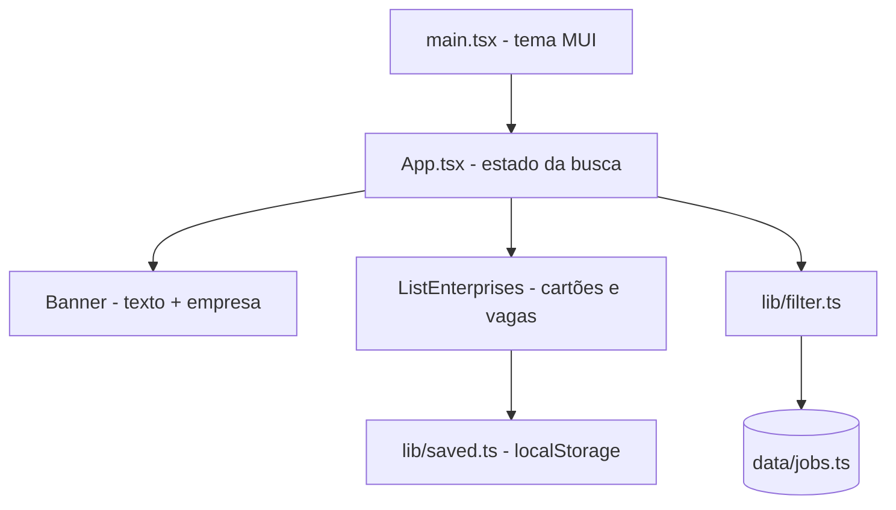

# Arquitetura — Oxe Online

## ADRs

| # | Decisão | Motivo | Alternativa |
|---|---|---|---|
| ADR-01 | Dados das vagas em um arquivo tipado | Fonte única; trocar por API depois sem mexer nos componentes | JSX fixo |
| ADR-02 | Filtro no cliente, sem acento | Poucas vagas; resposta instantânea | Busca no servidor |
| ADR-03 | Vagas salvas em localStorage | Preferência pessoal, sem conta | Back-end |
| ADR-04 | MUI 7 com emotion; sem styled-components | Um só motor de estilos | Manter os dois |
